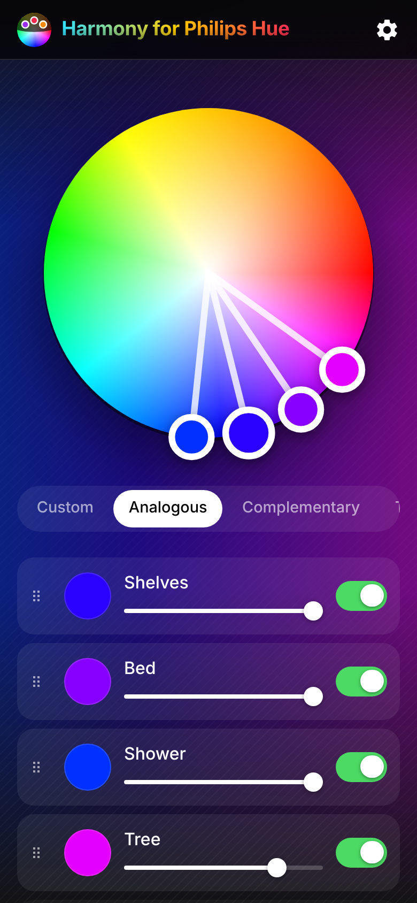
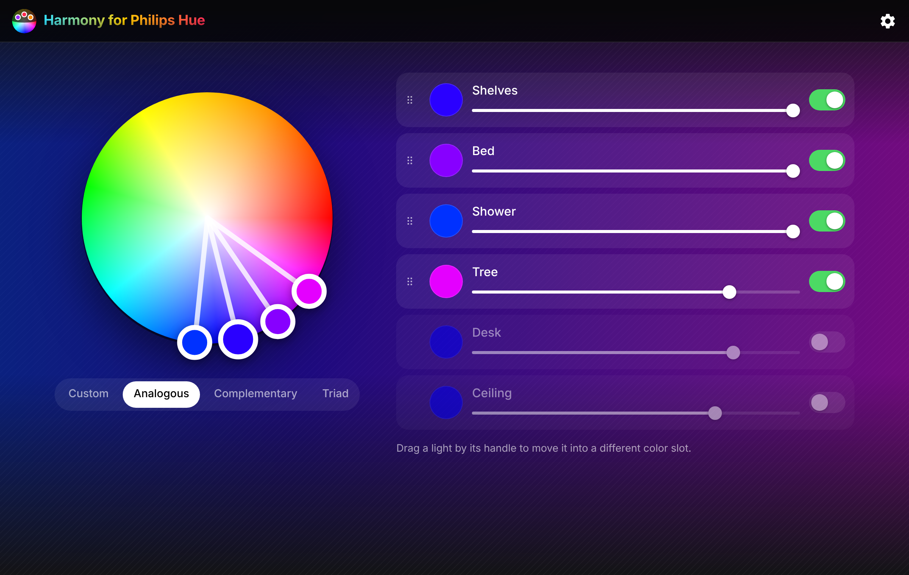

# Harmony for Philips Hue

Set your Philips Hue lights using the color relationships on an artist's color
wheel: analogous, complementary, triad, tetrad and monochromatic palettes, or
pick each light's color by hand. Inspired by [Adobe Color](https://color.adobe.com).

Use it at <https://benknight.github.io/hue-harmony/>.

The app is plain HTML, CSS and JavaScript. There is no build step, no framework
and no runtime dependency.

 

## Running it

Serve the folder over HTTP and open `index.html`. Any static server works:

```sh
python3 -m http.server 8000
# or
npx serve .
```

Then open <http://localhost:8000>. ES modules do not load from `file://` URLs,
so a server is required.

### Connecting to your bridge

On first launch the app asks Philips' discovery service for bridges on your
network, then prompts you to press the link button on the bridge. The generated
username is kept in `localStorage`, so this only happens once.

If discovery does not find your bridge, or you have more than one, open
Settings (gear icon), turn off automatic discovery and enter the bridge's IP
address.

### Serving over https (GitHub Pages)

Browsers refuse to call an `http://` address from a page served over
`https://`, so when the app itself is on https it talks to the bridge over
https as well. The bridge's certificate is not trusted by browsers, so the
first time the app will ask you to open `https://<bridge ip>/` in a new tab
and accept the certificate warning; it reconnects when you come back. Chrome
may also ask permission for the site to reach devices on your local network.
Bridges running firmware older than 2018 do not support https; serve the app
over plain `http://` or from `localhost` for those.

### Demo mode

Add `?demo` to the URL, or choose "Try the demo" when no bridge is found, to
use a set of pretend lights instead of real ones.

## Using it

- **Wheel.** Drag a marker to change that light's hue and saturation. In any
  mode other than Custom the other markers follow, keeping the harmony. The
  first light in the list is the root of the harmony. Markers can also be
  focused with the keyboard and nudged with the arrow keys (hold Shift for
  bigger steps).
- **Harmony modes.** Custom, Analogous, Complementary, Triad, Tetrad and
  Monochromatic. In Analogous mode, dragging a non-root marker changes the
  spacing between colors.
- **Lights.** Each light has an on/off switch and a brightness slider. Lights
  that are off drop to the bottom of the list and are left out of the harmony.
- **Reordering.** Drag a light by its handle to move it into a different color
  slot: the colors stay where they are and the lights swap between them.
- **Settings.** Set the bridge IP address, choose which lights Harmony is
  allowed to control, or reset everything.

## Project layout

```
index.html            App shell, light row template, settings dialog
css/style.css         All styles; design tokens live in :root
js/main.js            App startup, bridge connection, settings, light sync
js/wheel.js           ColorWheel component: SVG markers, dragging, harmonies
js/lights.js          LightList component: switches, sliders, drag reordering
js/hue.js             Hue bridge API client and the demo bridge
js/color.js           HSV/RGB/hex, CIE 1931 xy and artistic hue conversions
js/settings.js        localStorage persistence
js/toast.js           Status messages
demo.json             Bridge state used by demo mode
manifest.webmanifest  Installable web app manifest
```

## Deploying

The site is served by GitHub Pages from the `gh-pages` branch of
[benknight/hue-harmony](https://github.com/benknight/hue-harmony). Pushing to
that branch publishes it; there is nothing to build.

The hue mapping and harmony math are adapted from Adobe Kuler's color wheel; the
RGB to CIE xy conversion follows the Philips Hue developer documentation.
